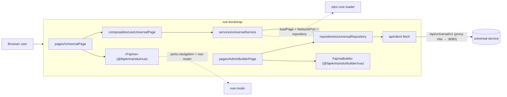
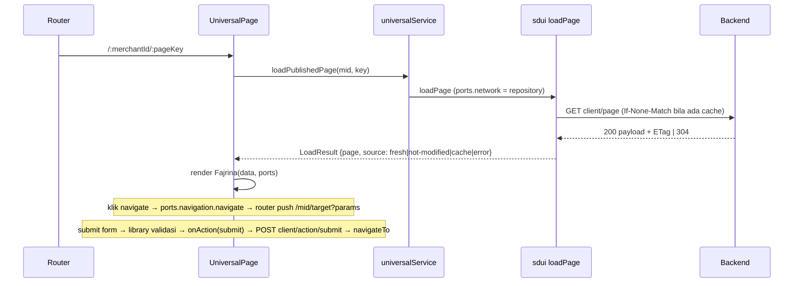
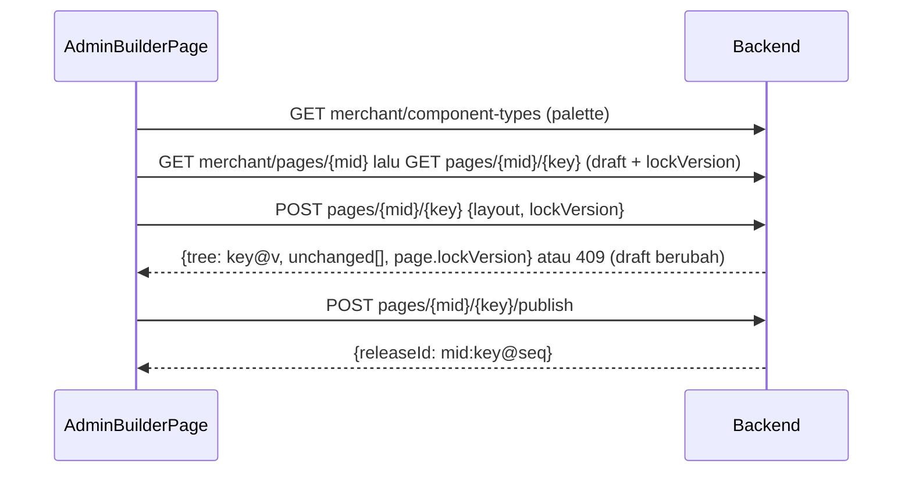

# HANDOFF — vue-bootstrap (aplikasi konsumen Vue)

> Tanggal: 2026-11-10 · Memakai `@fajekrina/sdui` 0.3.0 (workspace link ke `packages/sdui`)
> Pasangan: `packages/sdui/HANDOFF.md`, `universal-service/HANDOFF.md`, `react-tailwind/HANDOFF.md`

## 1. Apa ini
Demo Vue 3 + vue-router 4 + Bootstrap 5. Halaman `/:merchantId/:pageKey` dirender sepenuhnya dari JSON
backend; `/admin/builder` adalah builder (Save/Publish ke backend). Perilakunya sama dengan react-tailwind.

## 2. Desain sistem

### 2.1 Posisi dalam sistem


### 2.2 Lapisan aplikasi
| Lapisan | Tanggung jawab | Tidak boleh |
|---|---|---|
| `api/client.ts` | fetch ke `/api/universal/v1`, `raw()` untuk status/header (ETag), pesan error dari `errorMessage` | logika bisnis |
| `repositories/` | 1:1 endpoint backend (client + merchant) | cache, validasi |
| `services/` | memasang repository sebagai **NetworkPort** untuk `loadPage` library sdui (ETag, last-good cache, validasi ulang); `submitAction` | menyentuh UI |
| `composables/useUniversalPage` | state halaman: `data`, `error`, `source`, `loading`; abort request lama | memanggil fetch langsung |
| `pages/` | routing, `ports.navigation` → router, `onAction` hanya untuk `submit` | merender komponen SDUI sendiri |

Styling demo (Bootstrap) hanya untuk shell halaman (banner error/offline); komponen SDUI tetap inline style dari library sdui.

### 2.3 Alur halaman publik


### 2.4 Alur admin builder


### 2.5 Kontrak yang dipakai
- Backend (base `/api/universal/v1`, error `{errorDesc, errorCode, errorMessage}`): `GET client/page/{mid}/{key}` (ETag/304), `POST client/action/submit`, `GET|POST merchant/pages/...`, `POST .../publish`, `POST .../rollback?to=`, `GET merchant/releases/...` (`{releases:[…]}`), `GET merchant/component-types`.
- Library sdui: `loadPage`, `resolvePorts`, `browserStorage`, `<Fajrina data ports onAction>`; `FajrinaActionEvent.behavior` `submit` ditangani aplikasi, `blocked` hanya di-log, sisanya ditangani library.

## 3. Status
| | |
|---|---|
| Tes | `npx vitest run` → 3 tes lulus (`src/services/universalService.test.ts`) |
| Build | `npm run build` (vue-tsc -b + vite) bersih |
| Live | dev server 5174 → proxy `/api` ke 8080: ETag + 304 lewat proxy terverifikasi |

## 4. Menjalankan
```bash
# backend dulu: universal-service → ./gradlew bootRun (8080)
npm run build -w @fajekrina/sdui     # dari root C:\sdui, bila library sdui berubah
npm run dev                          # http://localhost:5174/merchant_demo/home
```

## 5. Yang berubah (ikut sdui 0.3)
- `repositories/universalRepository.ts`, `services/universalService.ts`: identik dengan versi React (repository = NetworkPort untuk loader library; ETag, last-good cache).
- `composables/useUniversalPage.ts`: `data/error/source/loading`, abort request lama.
- `pages/UniversalPage.vue`: `:ports` → vue-router (`router.push({ path, query: params })`, `router.back()`); `@action` hanya mengurus `submit`; alert Bootstrap untuk error & offline.
- `pages/AdminBuilderPage.vue`: palette dari `GET /merchant/component-types`; `lockVersion` saat simpan (409 → pesan jelas); status publish menampilkan `merchant:page@seq`.
- `api/client.ts`: base `/api/universal/v1` (backend kini berversi), pesan error dibaca dari `errorMessage` (kontrak error baru backend), `raw()` dan `put()`.
- Library sdui: komponen Vue `Fajrina` kini membungkus output dengan satu `<div>` (sebelumnya fragment).

## 6. Catatan
- Repository + service sengaja disalin sama dengan React; bila berubah, ubah keduanya (atau pindahkan ke paket bersama).
- Belum diuji klik di browser sungguhan oleh saya (hanya build, unit test, dan request lewat proxy dev).

## 7. Langkah berikut
- Halaman riwayat release + rollback di admin.
- E2E (Playwright) untuk alur home → seat-selection → checkout.
